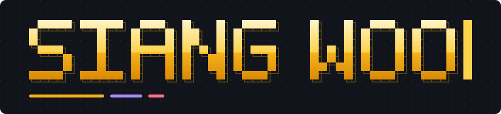

<p align="center">
  
</p>

<p align="center">
  <a href="https://www.linkedin.com/in/siah-business"></a>
  <a href="https://x.com/wooogydev"></a>
</p>

<p align="center">
<picture>
  <source media="(prefers-color-scheme: dark)" srcset="https://readme-typing-svg.demolab.com?font=JetBrains+Mono&weight=600&size=22&pause=900&color=F5B21B&center=true&vCenter=true&width=600&lines=Fintech+%2B+AI+student+%40+SIT+Singapore;I+find+the+problem+worth+solving;Idea+%E2%86%92+architecture+%E2%86%92+pitch;6+hackathons+and+counting;Now+playing%3A+SingHacks+2026+finals" />
  
</picture>
</p>

```console
siangwoo@sit:~$ whoami
Siang Woo · Applied Computing (Fintech) @ SIT, Singapore

siangwoo@sit:~$ cat role.txt
> ideation       talk to users, find the problem worth solving
> architecture   shape the system: agents, data, flows, guardrails
> pitching       tell the story so judges get it in 3 minutes

siangwoo@sit:~$ cat now.txt
> SingHacks 2026 finals
```

## 🎮 Quest log

<details open>
<summary><b>🥇 Uno Dos Tres</b> · an UNO table that reacts to real cards · <i>People's Choice Award</i></summary>
<br/>

Players hold real cards around a real table. A camera reads each card and a projector answers with colour, animation and sound. Built with team Uno Dos Tres for the Common Ground Makeathon (Design x Tech).

<a href="https://youtu.be/ds_KeTADAfw"></a>

[Repo](https://github.com/aurasakura/uno-table) · [Demo video](https://youtu.be/ds_KeTADAfw) · *Common Ground Makeathon*

</details>

<details>
<summary><b>🏅 Kopi That!</b> · learn to order kopi in a 3D hawker centre · <i>Top 6 teams</i></summary>
<br/>

Walk around a 3D hawker hall, meet the hawkers and practise ordering in local lingo, from *Kopi O Siew Dai Peng* to a Malay order for nasi lemak. Made for newcomers to Singapore.


[Play it](https://main.d225gi8pmcmeb4.amplifyapp.com/) · [Repo](https://github.com/ethancheang/AWSBuildBeyond) · *AWS Student AI Demo Challenge 2026*

</details>

<details>
<summary><b>✅ CrewKit Kitchen</b> · an AI chef that shops within budget, in Minecraft</summary>
<br/>

An agent turns an attendee list into a supply order through Reap's Agentic API. A budget gate blocks checkout until the cart fits, a human approves the payment, and a Minecraft kitchen shows every step. In the sandbox run the chef cut a S$196.85 quote down to S$102.75 to fit a S$105 budget.

<a href="https://youtu.be/yKMYXM9FWWQ"></a>

[Repo](https://github.com/aGamingGod1234/crewkit-kitchen) · [Demo video](https://youtu.be/yKMYXM9FWWQ) · *65Labs x Reap Agentic Buildathon 2026*

</details>

<details>
<summary><b>✅ TripCrew</b> · an AI travel crew in one Telegram group</summary>
<br/>

Drop a travel reel in the chat and it lands in your itinerary with a price. **Planner**, **Budget** and **Reel Adder** are three agents that talk to each other, track spending, split the bill, and show up in a live pixel-art view.


[Repo](https://github.com/xxycoc/tripcrew) · [Demo video](https://youtu.be/Calm0sUoz6k) · *WeMakeDevs Flip the Switch*

</details>

<details>
<summary><b>✅ Scamagotchi</b> · survive scams from school to retirement</summary>
<br/>

A browser life sim set in Singapore. Earn simulated SGD, grow up, and decide which messages, calls and offers are scams and which are real chances.


[Repo](https://github.com/xxycoc/digital4good-hackathon) · *GovTech Digital4Good hackathon*

</details>

<details>
<summary><b>✅ Rocks Fall, We All Die</b> · hikers vs the mountain</summary>
<br/>

A multiplayer Godot game. Everyone else climbs. One player **is** the mountain, dropping boulders and mud on them.


[Repo](https://github.com/xxycoc/Rocks-Fall-We-All-Die)

</details>

<details>
<summary><b>⏳ SingHacks 2026</b> · finals in progress</summary>
<br/>

Pitching in the finals on 18 Nov. More after the results.

</details>

## 🏆 Hackathons


<br/>


## 🧰 What my teams build with


```console
siangwoo@sit:~$ echo "thanks for stopping by"
thanks for stopping by
```
